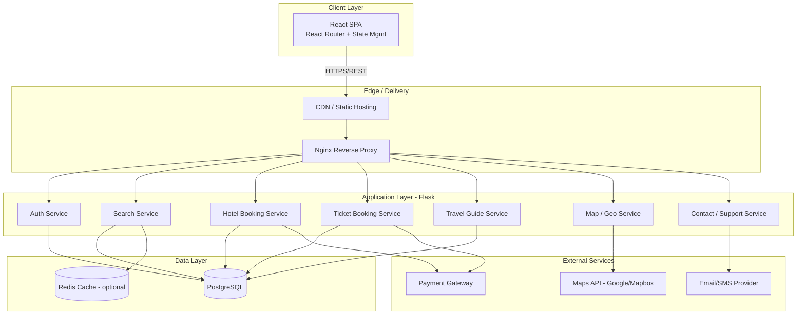

# TravelEase — Technical Architecture

**Stack:** React (frontend) · Python Flask (backend) · PostgreSQL (database)

## 1.1 High-Level Architecture



## 1.2 Frontend Architecture (React)

- **Structure:** Component-based SPA using functional components + Hooks
- **Routing:** React Router (public routes: Home, About, Contact, Search; protected routes: Bookings, Profile)
- **State management:** Context API for auth/session; Redux Toolkit or Zustand if state grows complex
- **Data fetching:** Axios with a centralized API client (interceptors for auth tokens, error handling)
- **Suggested folder structure:**
```
src/
 ├─ api/            # axios instances, endpoint definitions
 ├─ components/     # reusable UI (Navbar, Footer, Card, Modal)
 ├─ features/
 │   ├─ auth/
 │   ├─ search/
 │   ├─ hotels/
 │   ├─ tickets/
 │   ├─ guides/
 │   └─ map/
 ├─ pages/          # Home, Login, About, Contact, SearchResults, BookingConfirm
 ├─ hooks/          # custom hooks (useAuth, useDebounce)
 ├─ context/        # AuthContext, ThemeContext
 ├─ utils/          # validators, formatters
 └─ assets/
```

## 1.3 Backend Architecture (Flask)

- **Pattern:** Layered — Routes (Blueprints) → Services (business logic) → Models (SQLAlchemy ORM) → DB
- **Modules as Flask Blueprints:**
  - `auth_bp` — register, login, logout, refresh token
  - `search_bp` — unified search across hotels/tickets/guides
  - `hotels_bp` — hotel listing, availability, booking
  - `tickets_bp` — travel tickets (flights/trains/buses), booking
  - `guides_bp` — travel guide listing & booking
  - `map_bp` — geo lookups, points of interest
  - `contact_bp` — contact form submissions
- **API style:** RESTful JSON APIs, versioned (`/api/v1/...`)
- **Task handling:** Celery + Redis (optional) for async jobs like booking confirmation emails

## 1.4 Database Architecture (PostgreSQL)

Core tables:
- `users` (id, name, email, password_hash, role, created_at)
- `hotels` (id, name, location, price, amenities, rating)
- `hotel_bookings` (id, user_id, hotel_id, check_in, check_out, status, payment_id)
- `tickets` (id, type, origin, destination, departure_time, price, seats_available)
- `ticket_bookings` (id, user_id, ticket_id, seat_no, status, payment_id)
- `travel_guides` (id, name, region, languages, price_per_day, bio)
- `guide_bookings` (id, user_id, guide_id, start_date, end_date, status)
- `payments` (id, user_id, booking_type, booking_id, amount, status, gateway_ref)
- `contact_messages` (id, name, email, message, created_at)

Relationships: `users` 1—N `hotel_bookings` / `ticket_bookings` / `guide_bookings`; each booking type links to `payments`.

## 1.5 Core API Endpoints (sample)

| Method | Endpoint | Purpose |
|---|---|---|
| POST | `/api/v1/auth/register` | Create account |
| POST | `/api/v1/auth/login` | Authenticate, issue JWT |
| GET | `/api/v1/search?q=&type=` | Unified search |
| GET | `/api/v1/hotels/:id` | Hotel details |
| POST | `/api/v1/hotels/:id/book` | Book a hotel |
| GET | `/api/v1/tickets` | List/search tickets |
| POST | `/api/v1/tickets/:id/book` | Book a ticket |
| GET | `/api/v1/guides` | List travel guides |
| POST | `/api/v1/guides/:id/book` | Book a guide |
| GET | `/api/v1/map/poi` | Points of interest near location |
| POST | `/api/v1/contact` | Submit contact form |
