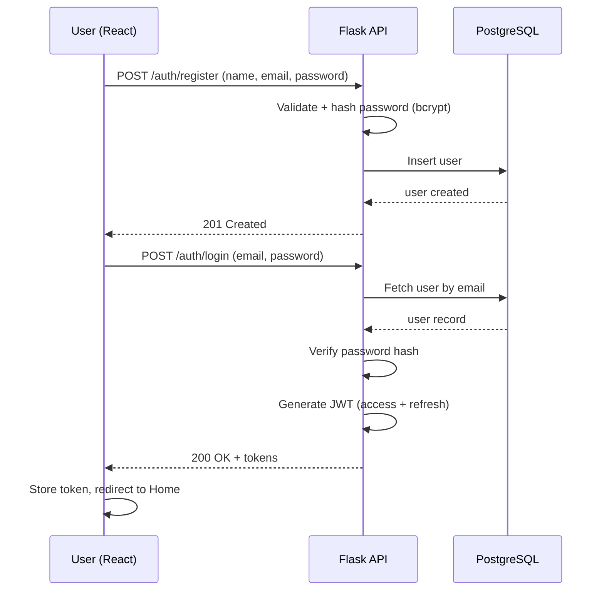
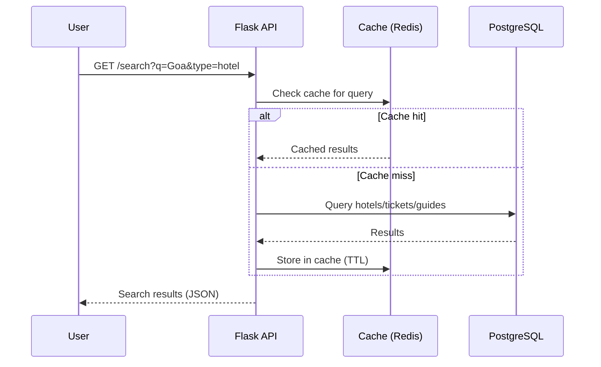
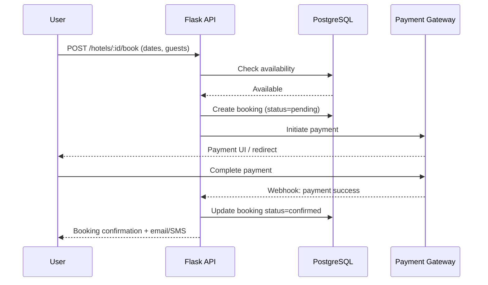
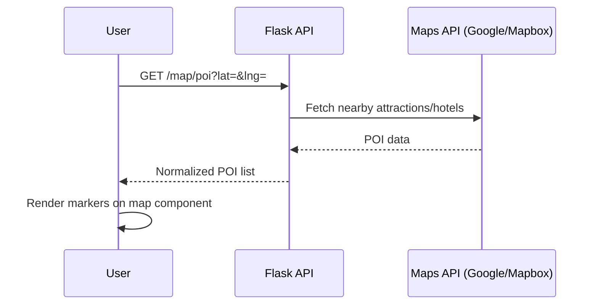

# TravelEase — System Workflow

## 2.1 Login / Registration Flow

## 2.2 Search Flow

## 2.3 Hotel / Ticket Booking Flow

Ticket booking follows the identical pattern against the `tickets` / `ticket_bookings` tables (seat check instead of date-range availability).

## 2.4 Travel Guide Booking Flow

Same pattern as hotel booking: check guide availability for date range → create pending booking → payment → confirm → notify both user and guide.

## 2.5 Map Integration Flow

